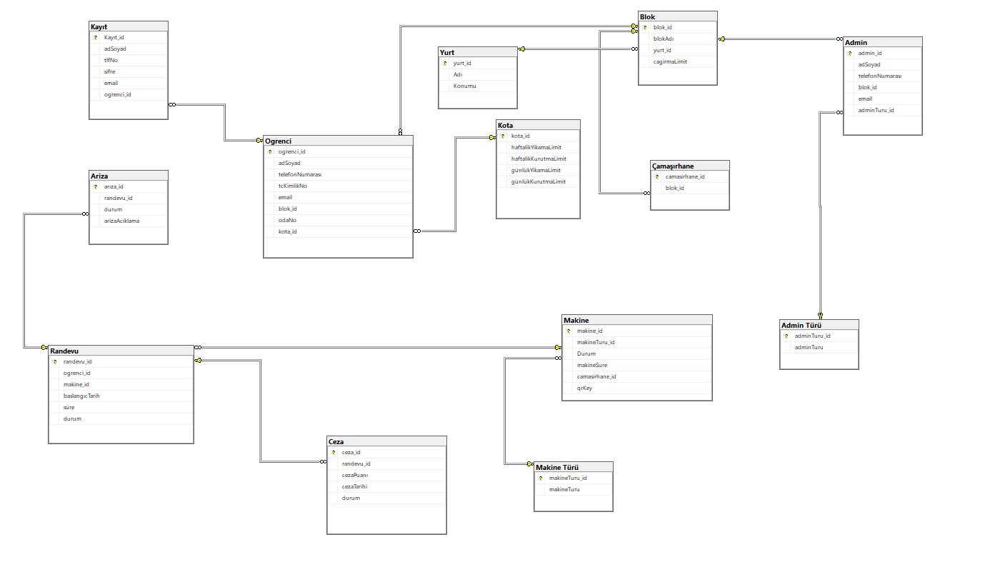

# 🧺 Çamaşırhanem — Yurt Çamaşırhane Otomasyon Sistemi

> Yurt çamaşırhanesi için uçtan uca sistem analizi, tasarımı ve web tabanlı prototip: fizibilite, Gantt planı, karar tabloları, DFD/ER diyagramları ve HTML/CSS/JavaScript arayüzü.
>
> *End-to-end system analysis & design project for a dormitory laundry: feasibility study, Gantt plan, decision tables, DFD/ER diagrams and an HTML/CSS/JS web prototype.*


## 📌 Proje Hakkında

Bu proje, bir yurt çamaşırhanesinin dijital dönüşüm sürecini **Sistem Analizi ve Tasarımı** yaklaşımıyla ele alır. Proje hem yönetimsel analizleri (fizibilite, planlama, karar mekanizmaları) hem de bu analizlere dayanarak geliştirilen web arayüzü prototipini içerir.

## ✨ Prototip Özellikleri

- **Giriş / Kayıt:** Öğrenci kayıt ekranı ve rol tabanlı giriş (öğrenci / yönetici)
- **Öğrenci paneli:** Makine durumlarını görüntüleme ve çamaşırhane işlemleri
- **Yönetici paneli:** Çamaşırhane kurallarının ve sistemin yönetimi
- **Bildirimler:** Toast mesajlarıyla kullanıcı geri bildirimi
- Veriler tarayıcının `localStorage` alanında tutulur (sunucusuz prototip)

**Demo hesapları**

| Rol | Kullanıcı adı | Şifre |
| --- | --- | --- |
| Yönetici | `admin` | `1234` |
| Öğrenci | `ogrenci` | `1234` |

## 📁 Proje Yapısı

```
.
├── src/                          # Web prototipi (HTML, CSS, JavaScript)
│   ├── login.html                # Giriş ekranı (başlangıç sayfası)
│   ├── register.html             # Öğrenci kayıt ekranı
│   ├── camasirhane.html          # Öğrenci paneli
│   └── admin.html                # Yönetici paneli
├── docs/                         # Proje dokümantasyonu
│   ├── sistem-analizi-raporu.docx
│   ├── sistem-analizi-sunumu.pptx
│   ├── gantt-semasi.xlsx
│   └── karar-tablosu.xlsx
└── assets/                       # Tasarım çıktıları
    ├── veritabani-semasi.png
    └── diyagramlar/
        ├── is-akis-diyagrami.drawio
        ├── veri-akis-diyagrami.drawio
        ├── varlik-iliski-diyagrami.drawio
        └── ag-tasarimi.drawio
```

## 📊 Analiz ve Tasarım Çıktıları

| Çıktı | Dosya |
| --- | --- |
| Sistem analizi raporu (fizibilite, maliyet ve geri dönüş analizi) | `docs/sistem-analizi-raporu.docx` |
| Proje sunumu | `docs/sistem-analizi-sunumu.pptx` |
| Proje planı (Gantt şeması) | `docs/gantt-semasi.xlsx` |
| Karar tablosu | `docs/karar-tablosu.xlsx` |
| İş akış diyagramı | `assets/diyagramlar/is-akis-diyagrami.drawio` |
| Veri akış diyagramı (DFD) | `assets/diyagramlar/veri-akis-diyagrami.drawio` |
| Varlık–ilişki diyagramı (ER) | `assets/diyagramlar/varlik-iliski-diyagrami.drawio` |
| Ağ tasarımı | `assets/diyagramlar/ag-tasarimi.drawio` |
| Veritabanı şeması | `assets/veritabani-semasi.png` |

### 🗄️ Veritabanı Şeması



> `.drawio` dosyaları [app.diagrams.net](https://app.diagrams.net) üzerinden açılabilir.

## 🚀 Çalıştırma

Kurulum gerekmez. Depoyu klonlayıp `src/login.html` dosyasını tarayıcıda açmanız yeterlidir.

## 🛠️ Kullanılan Teknolojiler ve Araçlar

- **Yazılım:** HTML5, CSS3, JavaScript
- **Analiz & Tasarım:** draw.io (diyagramlar), Microsoft Excel (Gantt & karar tabloları), Microsoft Word & PowerPoint (raporlama)

## 👩‍💻 Geliştirici

**Zeynep Erdem** — [github.com/zeyerdm](https://github.com/zeyerdm)
